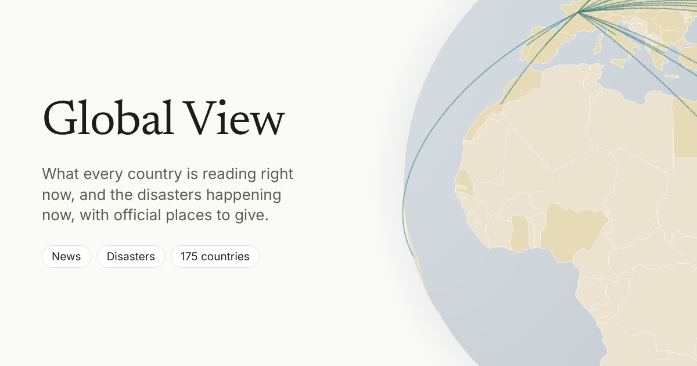

# Global View



A light, clean website with an interactive globe and two maps, switched with a News | Disasters toggle.

**News.** Click a country to see its news right now, each story linking to its publisher. The list comes from its Google News edition (top stories and the national and world sections) and, for all but China, a Bing News search in its language, grouped by story and ranked so fresh, widely carried stories come first; the freshest of those are tagged Trending. Headlines stay in the country's language with an English translation underneath. Countries without an edition show a news search instead (their own outlets in their language and English coverage, ranked the same way), clearly labelled and drawn a shade paler. "Trending today" lists the stories read in the most countries. Lines on the globe join countries reading the same story, each country's panel shows who it is reading about and who reads about it, and a day control steps back through a daily archive.

**Disasters.** The significant and severe natural disasters happening now (earthquakes, cyclones, floods, wildfires, volcanoes, droughts and more), each drawn over its real affected area, from GDACS, USGS, NASA EONET, IFRC GO and the site's own headlines (rated by the deaths their headlines report). Clicking a country lists the disasters ongoing there. Clicking a disaster shows where to donate: first, under "Directly to people affected", GoFundMe's verified fundraisers for that disaster, GlobalGiving projects and GoFundMe's vetted partners, and charities' and local groups' own pages for that disaster that were checked automatically, each with a note on who checked it; then official pages for that disaster itself under "For this disaster" (its IFRC appeal, or an official page found for it), then the country's Red Cross or Red Crescent society, UN Crisis Relief and IFRC. Every page is chosen by fixed rules, never by hand or by a model alone, and the site never takes donations.

Every view has a shareable address. There is no account, no ads and no tracking.

The site is a static Next.js export. A GitHub Actions job refreshes the data every two hours and commits it to `public/data`; Cloudflare redeploys on every commit. The website never calls an API. The job uses the Claude API (Haiku) to translate headlines, group the same story across countries, spot disasters in headlines and research each disaster with web search, capped at $50 a month (see `pipeline/README.md`). No article text is stored: only headline, outlet, time and link.

## Develop

```bash
npm install
npm run dev          # site at http://localhost:3000
npm test             # pipeline and helper tests
npm run pipeline:update -- --countries TH   # refresh one country's data locally
npm run pipeline:update -- --no-ai          # feeds only, no model calls
```

## Build

```bash
npm run build        # writes the static site to /out
```

## Deploy on Cloudflare

The site is a Cloudflare Worker with static assets only (`wrangler.jsonc`): Cloudflare serves the files in `out/` and runs no code. To connect it, once:

1. In the Cloudflare dashboard, go to **Workers & Pages**, **Create**, **Import a repository**, and pick this GitHub repository.
2. Set the build command to `npm run build` and leave the deploy command as `npx wrangler deploy`. The Node version comes from `.node-version` (22).
3. Under **Build variables**, add `SITE_URL` with the site's address, for example `https://global-view.<your-subdomain>.workers.dev`, or your own domain once it is attached. Link previews and the sitemap use it. `GOOGLE_SITE_VERIFICATION` and `BING_SITE_VERIFICATION` go there too.

Cloudflare then builds and deploys every push to `main`, including the data job's commits every two hours (about 360 builds a month, well inside the free plan's 3,000 build minutes). Because `wrangler.jsonc` is already in the repository, Cloudflare does not need to open a pull request with its own configuration. `netlify.toml` stays only until the old Netlify site is switched off.

## Layout

| Path | What it is |
| --- | --- |
| `src/` | The website |
| `pipeline/` | The update script and its tests (see `pipeline/README.md`) |
| `data/countries.json` | Which countries are shown and which Google News edition each uses |
| `public/data/` | Generated article lists, shared stories, attention counts and the disaster map the site reads; written by the pipeline |
| `cache/headlines.json` | Translations already made, keyed by article link, so nothing is translated twice |
| `public/geo/countries.geojson` | Natural Earth 110m country shapes (public domain), slimmed down |
| `.github/workflows/update-news.yml` | The two-hourly update job |
| `wrangler.jsonc`, `.node-version` | How Cloudflare serves the site and which Node version builds it |
| `public/og.png` | The link preview image (1200 x 630); `src/lib/site.ts` holds the page title and description |
